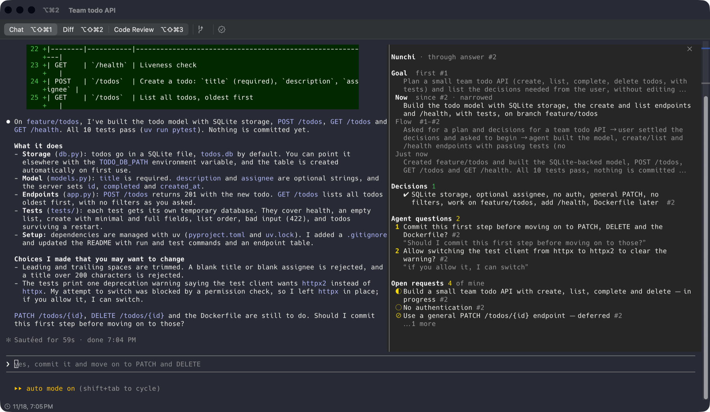

# nunchi

**Read the room in your Claude Code session.**

nunchi adds a side panel to a Claude Code session. When you come back to a session, it
shows where things stand: the current goal and how the conversation got there, the
decisions you made, what the agent is asking you, and which of your requests are still
open.

> *Nunchi (눈치)* is the Korean art of quickly reading a situation and acting on it.



## Install

Run this inside Claude Code:

```
/plugin install nunchi --marketplace JeanTracker/nunchi
```

Runs on macOS (Apple silicon or Intel) and Linux (x86_64 or arm64); Windows is not
supported. Installing is the same everywhere: the plugin ships an engine for each platform
and picks the right one, so it needs no Python. On Linux the engine passes its tests in
CI, but it has not yet been tried in a live session.

## Use

In a session you want to follow, type `/nunchi`. The panel opens on the right (or as one
line above the input box in a narrow window), and the session is analyzed after each
response from then on. Analysis runs `claude -p` in the background and uses your
account's quota; see the guide for how to limit it.

## Update and remove

```sh
claude plugin marketplace update nunchi && claude plugin update nunchi@nunchi
claude plugin uninstall nunchi@nunchi && claude plugin marketplace remove nunchi
```

Full guide: [docs/GUIDE.md](docs/GUIDE.md)

## Status

Early development. Turning the panel off for a session (`/nunchi off`) and a status
command are not built yet.

An earlier version also shipped a separate terminal app for watching several sessions at
once (the control screen, installed with `install.sh`). It has been removed and will be
rebuilt in Rust. If you installed it, run `install.sh --uninstall` from that version
before you update, so no hook is left pointing at a deleted script.

## License

[MIT](LICENSE)

nunchi is an independent project and is not affiliated with or endorsed by Anthropic.
